# ADR-017: MVP data model

- **Status**: accepted
- **Date**: 2026-09-24
- **Deciders**: echimine
- **Tags**: data-model, database, postgis, drizzle
- **Source**: Like-Strava architecture deck, slide 09 "Business entities"

## Context

Slide 09 describes the MVP data model: users and authentication, profile, activities and their computed data, social (follows between users, kudos, comments), sport types and segments. Later ADRs added needs that are not on it:
- **Better Auth** (ADR-009) needs a verification table and a **role** on the user for the admin guard (ADR-004, ADR-013);
- **RevenueCat** (ADR-014): the API must know each user's **premium status**, updated by the worker from webhooks.

The schema is written with **Drizzle** in `packages/db` (ADR-003), on **PostgreSQL + PostGIS**.

## Decision

### Conventions

| Topic | Rule |
|---|---|
| Naming | Tables and columns in `snake_case`, singular table names |
| Identifiers | `uuid`. An activity's identifier is **generated by the app** (idempotency, ADR-008); the others by the server |
| Dates | `timestamptz` (UTC) |
| Enumerations | PostgreSQL `enum` types |
| Geometry | PostGIS, SRID **4326** (WGS 84): `geometry(LineString, 4326)`, `geometry(Point, 4326)`, with **GiST** index |
| Deletion | Hard delete by default; soft delete (`deleted_at`) only for comments, as on the slide |
| Ownership | Each table belongs to **a single module** (ADR-003); other modules go through its service. Each module's tables live in a **PostgreSQL schema named after the module**, except Better Auth tables which stay in `public` (ADR-021) |
| Drizzle files | One schema file per module: `packages/db/src/schema/<module>.ts` |

### Schema

```mermaid
erDiagram
    USER ||--o{ SESSION : "better-auth"
    USER ||--o{ ACCOUNT : "better-auth"
    USER ||--|| USER_PROFILE : has
    USER ||--o{ FOLLOW : follows
    USER ||--o{ ACTIVITY : records
    USER ||--o{ COMMENT : writes
    USER ||--o{ KUDOS : gives
    USER ||--o{ USER_SUBSCRIPTION : "premium subscription"
    SPORT_TYPE ||--o{ ACTIVITY : "type of"
    SPORT_TYPE ||--o{ SEGMENT : "type of"
    ACTIVITY ||--|| ACTIVITY_STATS : "1-1"
    ACTIVITY ||--|| ACTIVITY_TRACK : "1-1 track"
    ACTIVITY ||--o{ ACTIVITY_ATTACHMENT : photos
    ACTIVITY ||--o{ COMMENT : receives
    ACTIVITY ||--o{ KUDOS : receives
    ACTIVITY ||--o{ SEGMENT_EFFORT : generates
    SEGMENT ||--o{ SEGMENT_EFFORT : ranks

    USER {
        uuid id PK
        string email UK
        boolean email_verified
        string name
        string image
        enum role "user or admin (added)"
        timestamp created_at
        timestamp updated_at
    }
    SESSION {
        uuid id PK
        uuid user_id FK
        string token UK
        timestamp expires_at
        string ip_address
        string user_agent
    }
    ACCOUNT {
        uuid id PK
        uuid user_id FK
        string provider_id
        string account_id
        string access_token
        string refresh_token
    }
    VERIFICATION {
        uuid id PK
        string identifier
        string value
        timestamp expires_at
    }
    USER_PROFILE {
        uuid user_id PK
        string first_name
        string last_name
        string avatar_url
        string country
        string city
        date birth_date
        string gender
        float weight_kg
        enum unit_system "metric or imperial"
        enum default_visibility
        int privacy_zone_radius_m
        timestamp updated_at
    }
    FOLLOW {
        uuid follower_id PK
        uuid followee_id PK
        enum status "pending or accepted"
        timestamp created_at
    }
    ACTIVITY {
        uuid id PK "generated by the client"
        uuid user_id FK
        string sport_type_code FK
        string title
        text description
        timestamp started_at
        timestamp ended_at
        enum visibility "public, followers, private"
        enum processing_status "pending, processing, processed, failed"
        boolean is_manual
        timestamp created_at
    }
    ACTIVITY_STATS {
        uuid activity_id PK
        float distance_m
        int moving_time_s
        int elapsed_time_s
        float elevation_gain_m
        float avg_speed_ms
        float max_speed_ms
        int avg_heart_rate
        int max_heart_rate
        int calories
    }
    ACTIVITY_TRACK {
        uuid activity_id PK
        geometry route "LineString 4326"
        geometry start_point "Point 4326"
        string raw_points_s3_key "raw points"
        string map_thumbnail_url
        int point_count
        string map_polyline "amended by ADR-029"
        string location_name "amended by ADR-029"
    }
    ACTIVITY_ATTACHMENT {
        uuid id PK
        uuid activity_id FK
        string s3_key
        enum kind "photo or video"
        int position
        geometry taken_at_point
        timestamp created_at
    }
    KUDOS {
        uuid user_id PK
        uuid activity_id PK
        timestamp created_at
    }
    COMMENT {
        uuid id PK
        uuid activity_id FK
        uuid user_id FK
        text body
        timestamp created_at
        timestamp deleted_at
    }
    SPORT_TYPE {
        string code PK "run, ride, swim"
        string category "foot, wheels, water"
        string icon_name
        boolean tracks_distance
        boolean tracks_elevation
        boolean uses_gps
        enum pace_unit
        int min_duration_s
        int min_distance_m
        int display_order
        boolean is_active
    }
    SEGMENT {
        uuid id PK
        string name
        string sport_type_code FK
        geometry path "LineString 4326"
        geometry start_point
        geometry end_point
        float distance_m
        float avg_grade
    }
    SEGMENT_EFFORT {
        uuid id PK
        uuid activity_id FK
        uuid segment_id FK
        uuid user_id FK
        int elapsed_time_s
        timestamp started_at
        int rank "denormalized"
    }
    USER_SUBSCRIPTION {
        uuid user_id PK
        string entitlement_id PK "premium"
        boolean is_active
        string product_id "App Store identifier"
        enum store "app_store"
        enum period_type "trial, intro, normal"
        boolean will_renew
        timestamp purchased_at
        timestamp expires_at
        timestamp grace_period_expires_at
        timestamp billing_issue_detected_at
        timestamp unsubscribe_detected_at
        enum environment "sandbox or production"
        timestamp synced_at
    }
    REVENUECAT_EVENT {
        string id PK "RevenueCat event identifier"
        uuid user_id FK
        string type
        jsonb payload
        timestamp received_at
        timestamp processed_at
    }
```

### Tables per module

| Module (`packages/core`) | PostgreSQL schema | Tables | Origin |
|---|---|---|---|
| `auth` | `public` | `user`, `session`, `account`, `verification` | Slide 09 + Better Auth additions |
| `users` | `users` | `user_profile` | Slide 09 |
| `social` | `social` | `follow` | Slide 09 |
| `engagement` | `engagement` | `kudos`, `comment` | Slide 09 (*amended by ADR-021*: split from `social`) |
| `sports` | `sports` | `sport_type` (reference data, populated by migration) | Slide 09 |
| `activities` | `activities` | `activity`, `activity_stats`, `activity_track`, `activity_attachment`, `activity_import` | Slide 09 (*amended by ADR-028*: `activity_import`) |
| `segments` | `segments` | `segment`, `segment_effort` | Slide 09 |
| `subscriptions` | `subscriptions` | `user_subscription`, `revenuecat_event` | **Addition** (ADR-014) |

*Amended by [ADR-021](ADR-021-bounded-contexts-and-module-boundaries.md)*: `kudos` and `comment` belong to the `engagement` module, and each module's tables live in a PostgreSQL schema named after it (Better Auth tables stay in `public`).

### Additions compared to slide 09

**1. Better Auth**
- `verification`: table required by Better Auth (email verification, password reset).
- `user.role` (`user` or `admin`): used by the API's admin guard (ADR-009) and by `GET /v1/me` (ADR-013). The exact columns will follow the schema generated by Better Auth (admin plugin).

**2. Subscriptions (RevenueCat)**
- `user_subscription`: **the user's premium state**, one row per user and per entitlement (`premium` for the MVP), in a table **owned by the `subscriptions` module**.
  - Written **only by the worker** (`sync-subscription`), from the full state read from the RevenueCat API (ADR-014). No Better Auth endpoint can modify it.
  - The API considers a user premium if `is_active` is true **and** `expires_at` (or `grace_period_expires_at` during a grace period) is in the future. The date acts as a **safety net**: if an expiration webhook is lost, the user does not stay premium indefinitely.
  - The detail columns (product, trial, renewal, billing issue) serve the backoffice and support, without going into RevenueCat.
  - `GET /v1/me` returns the premium status through a join on the primary key.
  - The `user` table stays exactly the Better Auth one (except for `role`).
- `revenuecat_event`: each webhook received, **deduplicated by its identifier**, with its raw content. Used to ignore duplicates, to replay a sync and to diagnose issues.

### No table for products or offerings

In RevenueCat, four concepts coexist:

| Concept | Role | Where it lives |
|---|---|---|
| **Product** | The product sold in the App Store (e.g. `premium_monthly`), with its price | App Store Connect, imported into RevenueCat |
| **Entitlement** | The right unlocked by a purchase (e.g. `premium`) | RevenueCat |
| **Offering** | The set of offers shown on the paywall, with its metadata; the one that changes in an experiment | RevenueCat |
| **Package** | One offer within an offering (monthly, annual…), which points to a product | RevenueCat |

We **do not copy** products or offerings into our database:
- the app fetches them **directly from RevenueCat** via the SDK, with the **localized prices** provided by the App Store; a copy would quickly be wrong (per-country prices, running experiments);
- the API only needs to know **whether the user has the `premium` entitlement**: that is the role of `user_subscription`;
- `user_subscription.product_id` keeps the identifier of the purchased product, enough for simple statistics in the backoffice; full revenue statistics are provided by RevenueCat and PostHog (ADR-014, ADR-015).

### Main indexes

| Table | Index | Usage |
|---|---|---|
| `activity` | `(user_id, started_at desc)` | A user's activities, feed |
| `activity` | Partial on `processing_status` (excluding `processed`) | Resync of in-progress activities (ADR-008) |
| `activity_track` | GiST on `route` and `start_point` | Spatial search, segment detection |
| `segment` | GiST on `path` and `start_point` | Segments near a route |
| `segment_effort` | `(segment_id, elapsed_time_s)` | Segment leaderboard |
| `follow` | `(followee_id, status)` | A user's followers |
| `comment` | Partial `(activity_id, created_at)` (`deleted_at is null`) | An activity's comments |
| `user_subscription` | Primary key `(user_id, entitlement_id)` | Premium check |

### For later (out of MVP scope)

- `device`: devices and APNs tokens for notifications (ADR-006, ADR-011).
- Processing-tracking columns (`processing_error`, `processing_attempts`, `processed_at`) on `activity`: **decided in [ADR-019](ADR-019-activity-creation-flow.md)**.
- *Amended by [ADR-028](ADR-028-activity-import-from-file.md)*: table `activity_import` (import of .gpx/.tcx/.fit files) and column `activity.source` (`recorded` / `imported` / `manual`).

## Alternatives Considered

| Option | Why rejected |
|---|---|
| `product` / `offering` tables synced from RevenueCat | Data already provided by the SDK with localized prices; a copy quickly goes out of sync, with no use on the API side |
| `is_premium` / `premium_expires_at` columns on `user` (Better Auth) | Mixes authentication and billing in a table managed by Better Auth; risk that a user modifies these fields themselves via Better Auth's update endpoint if the `input: false` option is forgotten; status possibly stale because of the session cache |
| Small `user_premium` table (boolean + date) | Enough for the API, but without the details useful to the backoffice and support (product, trial, renewal, billing issue) |
| `is_active` alone, without an expiration date | A lost expiration webhook would leave the user premium indefinitely |
| Store each GPS point as a separate row | Huge volume; the simplified route (`LineString`) goes into the database and the raw points into the bucket (`raw_points_s3_key`) |
| Auto-increment identifiers | Incompatible with the activity identifier generated offline by the app, and they expose the data volume |

## Consequences

### Positive
- Slide 09 model kept, extended only where later ADRs require it.
- Premium status checkable by the API without an external call.
- Each table has a clear owning module.
- Spatial queries and leaderboards covered by indexes.

### Negative / Risks
- **Better Auth columns**: the exact schema depends on the Better Auth version and plugins; to be generated and then integrated into `packages/db`.
- **Denormalized `segment_effort.rank`**: must be recomputed when a new effort changes the leaderboard (in the worker).
- **Health data** (`birth_date`, `weight_kg`, `gender`, heart rate): sensitive data under the GDPR, to be protected (access, export, account deletion).
- **`revenuecat_event` grows** over time: plan a purge of old, already processed events.

## References
- Like-Strava architecture deck, slide 09
- [ADR-003: Backend stack and architecture](ADR-003-backend.md)
- [ADR-014: Subscriptions with RevenueCat](ADR-014-revenuecat.md)
- Better Auth, core schema: https://www.better-auth.com/docs/concepts/database
- RevenueCat, entitlements, offerings and products: https://www.revenuecat.com/docs/getting-started/entitlements
- PostGIS: https://postgis.net/docs/

## Links

- **Amended by**: [ADR-019](ADR-019-activity-creation-flow.md) (processing-tracking columns), [ADR-021](ADR-021-bounded-contexts-and-module-boundaries.md) (`kudos` and `comment` move to the `engagement` module; one PostgreSQL schema per module), [ADR-028](ADR-028-activity-import-from-file.md) (`activity_import` table, `activity.source`), [ADR-029](ADR-029-activity-feed-and-card.md) (`activity_track.map_polyline`, `location_name`)
- **Related**: [ADR-003](ADR-003-backend.md) (modules and owned tables), [ADR-008](ADR-008-mobile-offline-sync.md), [ADR-009](ADR-009-backend-api.md), [ADR-011](ADR-011-backend-worker.md), [ADR-014](ADR-014-revenuecat.md), [ADR-022](ADR-022-authentication-better-auth.md) (`admin` plugin on the `role` column)
