# ADR-017 : Modèle de données du MVP

- **Statut** : accepted
- **Date** : 2026-09-24
- **Décideurs** : echimine
- **Source** : dossier d'architecture Like-Strava, slide 09 « Entités métier »
- **En lien avec** : [ADR-003](ADR-003-backend.md) (modules et tables possédées), [ADR-008](ADR-008-mobile-offline-sync.md), [ADR-009](ADR-009-backend-api.md), [ADR-011](ADR-011-backend-worker.md), [ADR-014](ADR-014-revenuecat.md)

## Contexte

La slide 09 décrit le modèle de données du MVP : utilisateurs et authentification, profil, activités et leurs données calculées, social (abonnements entre utilisateurs, kudos, commentaires), types de sport et segments. Les ADR suivants ont ajouté des besoins qui n'y figurent pas :
- **Better Auth** (ADR-009) a besoin d'une table de vérification et d'un **rôle** sur l'utilisateur pour la garde admin (ADR-004, ADR-013) ;
- **RevenueCat** (ADR-014) : l'API doit connaître le **statut premium** de chaque utilisateur, mis à jour par le worker à partir des webhooks.

Le schéma est écrit avec **Drizzle** dans `packages/db` (ADR-003), sur **PostgreSQL + PostGIS**.

## Décision

### Conventions

| Sujet | Règle |
|---|---|
| Nommage | Tables et colonnes en `snake_case`, noms de tables au singulier |
| Identifiants | `uuid`. L'identifiant d'une activité est **généré par l'app** (idempotence, ADR-008) ; les autres par le serveur |
| Dates | `timestamptz` (UTC) |
| Énumérations | Types `enum` PostgreSQL |
| Géométrie | PostGIS, SRID **4326** (WGS 84) : `geometry(LineString, 4326)`, `geometry(Point, 4326)`, avec index **GiST** |
| Suppression | Définitive par défaut ; suppression logique (`deleted_at`) uniquement pour les commentaires, comme sur la slide |
| Propriété | Chaque table appartient à **un seul module** (ADR-003) ; les autres modules passent par son service |
| Fichiers Drizzle | Un fichier de schéma par module : `packages/db/src/schema/<module>.ts` |

### Schéma

```mermaid
erDiagram
    USER ||--o{ SESSION : "better-auth"
    USER ||--o{ ACCOUNT : "better-auth"
    USER ||--|| USER_PROFILE : a
    USER ||--o{ FOLLOW : suit
    USER ||--o{ ACTIVITY : enregistre
    USER ||--o{ COMMENT : ecrit
    USER ||--o{ KUDOS : donne
    USER ||--o{ USER_SUBSCRIPTION : "abonnement premium"
    SPORT_TYPE ||--o{ ACTIVITY : "type de"
    SPORT_TYPE ||--o{ SEGMENT : "type de"
    ACTIVITY ||--|| ACTIVITY_STATS : "1-1"
    ACTIVITY ||--|| ACTIVITY_TRACK : "1-1 trace"
    ACTIVITY ||--o{ ACTIVITY_ATTACHMENT : photos
    ACTIVITY ||--o{ COMMENT : recoit
    ACTIVITY ||--o{ KUDOS : recoit
    ACTIVITY ||--o{ SEGMENT_EFFORT : genere
    SEGMENT ||--o{ SEGMENT_EFFORT : classe

    USER {
        uuid id PK
        string email UK
        boolean email_verified
        string name
        string image
        enum role "user ou admin (ajout)"
        timestamp created_at
        timestamp updated_at
    }
    SESSION {
        uuid id PK
        uuid user_id FK
        string token UK
        timestamp expires_at
        string ip_address
        string user_agent
    }
    ACCOUNT {
        uuid id PK
        uuid user_id FK
        string provider_id
        string account_id
        string access_token
        string refresh_token
    }
    VERIFICATION {
        uuid id PK
        string identifier
        string value
        timestamp expires_at
    }
    USER_PROFILE {
        uuid user_id PK
        string first_name
        string last_name
        string avatar_url
        string country
        string city
        date birth_date
        string gender
        float weight_kg
        enum unit_system "metric ou imperial"
        enum default_visibility
        int privacy_zone_radius_m
        timestamp updated_at
    }
    FOLLOW {
        uuid follower_id PK
        uuid followee_id PK
        enum status "pending ou accepted"
        timestamp created_at
    }
    ACTIVITY {
        uuid id PK "genere par le client"
        uuid user_id FK
        string sport_type_code FK
        string title
        text description
        timestamp started_at
        timestamp ended_at
        enum visibility "public, followers, private"
        enum processing_status "pending, processing, processed, failed"
        boolean is_manual
        timestamp created_at
    }
    ACTIVITY_STATS {
        uuid activity_id PK
        float distance_m
        int moving_time_s
        int elapsed_time_s
        float elevation_gain_m
        float avg_speed_ms
        float max_speed_ms
        int avg_heart_rate
        int max_heart_rate
        int calories
    }
    ACTIVITY_TRACK {
        uuid activity_id PK
        geometry route "LineString 4326"
        geometry start_point "Point 4326"
        string raw_points_s3_key "points bruts"
        string map_thumbnail_url
        int point_count
    }
    ACTIVITY_ATTACHMENT {
        uuid id PK
        uuid activity_id FK
        string s3_key
        enum kind "photo ou video"
        int position
        geometry taken_at_point
        timestamp created_at
    }
    KUDOS {
        uuid user_id PK
        uuid activity_id PK
        timestamp created_at
    }
    COMMENT {
        uuid id PK
        uuid activity_id FK
        uuid user_id FK
        text body
        timestamp created_at
        timestamp deleted_at
    }
    SPORT_TYPE {
        string code PK "run, ride, swim"
        string category "foot, wheels, water"
        string icon_name
        boolean tracks_distance
        boolean tracks_elevation
        boolean uses_gps
        enum pace_unit
        int min_duration_s
        int min_distance_m
        int display_order
        boolean is_active
    }
    SEGMENT {
        uuid id PK
        string name
        string sport_type_code FK
        geometry path "LineString 4326"
        geometry start_point
        geometry end_point
        float distance_m
        float avg_grade
    }
    SEGMENT_EFFORT {
        uuid id PK
        uuid activity_id FK
        uuid segment_id FK
        uuid user_id FK
        int elapsed_time_s
        timestamp started_at
        int rank "denormalise"
    }
    USER_SUBSCRIPTION {
        uuid user_id PK
        string entitlement_id PK "premium"
        boolean is_active
        string product_id "identifiant App Store"
        enum store "app_store"
        enum period_type "trial, intro, normal"
        boolean will_renew
        timestamp purchased_at
        timestamp expires_at
        timestamp grace_period_expires_at
        timestamp billing_issue_detected_at
        timestamp unsubscribe_detected_at
        enum environment "sandbox ou production"
        timestamp synced_at
    }
    REVENUECAT_EVENT {
        string id PK "identifiant de l'evenement RevenueCat"
        uuid user_id FK
        string type
        jsonb payload
        timestamp received_at
        timestamp processed_at
    }
```

### Tables par module

| Module (`packages/core`) | Tables | Origine |
|---|---|---|
| `auth` | `user`, `session`, `account`, `verification` | Slide 09 + ajouts Better Auth |
| `users` | `user_profile` | Slide 09 |
| `social` | `follow`, `kudos`, `comment` | Slide 09 |
| `sports` | `sport_type` (données de référence, alimentées par migration) | Slide 09 |
| `activities` | `activity`, `activity_stats`, `activity_track`, `activity_attachment` | Slide 09 |
| `segments` | `segment`, `segment_effort` | Slide 09 |
| `subscriptions` | `user_subscription`, `revenuecat_event` | **Ajout** (ADR-014) |

### Ajouts par rapport à la slide 09

**1. Better Auth**
- `verification` : table exigée par Better Auth (vérification d'e-mail, réinitialisation de mot de passe).
- `user.role` (`user` ou `admin`) : utilisé par la garde admin de l'API (ADR-009) et par `GET /v1/me` (ADR-013). Les colonnes exactes suivront le schéma généré par Better Auth (plugin admin).

**2. Abonnements (RevenueCat)**
- `user_subscription` : **l'état premium de l'utilisateur**, une ligne par utilisateur et par entitlement (`premium` pour le MVP), dans une table **possédée par le module `subscriptions`**.
  - Écrite **uniquement par le worker** (`sync-subscription`), à partir de l'état complet lu dans l'API RevenueCat (ADR-014). Aucun endpoint de Better Auth ne peut la modifier.
  - L'API considère un utilisateur premium si `is_active` est vrai **et** `expires_at` (ou `grace_period_expires_at` pendant une période de grâce) est dans le futur. La date sert de **filet de sécurité** : si un webhook d'expiration est perdu, l'utilisateur ne reste pas premium indéfiniment.
  - Les colonnes de détail (produit, essai, renouvellement, problème de paiement) servent au backoffice et au support, sans aller dans RevenueCat.
  - `GET /v1/me` renvoie le statut premium par une jointure sur la clé primaire.
  - La table `user` reste exactement celle de Better Auth (hors `role`).
- `revenuecat_event` : chaque webhook reçu, **dédupliqué par son identifiant**, avec son contenu brut. Sert à ignorer les doublons, à rejouer une synchronisation et à diagnostiquer.

### Pas de table pour les produits ni les offerings

Dans RevenueCat, quatre notions coexistent :

| Notion | Rôle | Où elle vit |
|---|---|---|
| **Product** | Le produit vendu dans l'App Store (ex. `premium_monthly`), avec son prix | App Store Connect, importé dans RevenueCat |
| **Entitlement** | Le droit débloqué par un achat (ex. `premium`) | RevenueCat |
| **Offering** | L'ensemble d'offres présenté sur le paywall, avec ses métadonnées ; celui qui change dans une expérience | RevenueCat |
| **Package** | Une offre dans un offering (mensuel, annuel…), qui pointe vers un product | RevenueCat |

On **ne copie pas** les products ni les offerings dans notre base :
- l'app les récupère **directement depuis RevenueCat** via le SDK, avec les **prix localisés** fournis par l'App Store ; une copie serait vite fausse (prix par pays, expériences en cours) ;
- l'API n'a besoin que de savoir **si l'utilisateur a l'entitlement `premium`** : c'est le rôle de `user_subscription` ;
- `user_subscription.product_id` garde l'identifiant du produit acheté, suffisant pour des statistiques simples dans le backoffice ; les statistiques de revenus complètes sont fournies par RevenueCat et PostHog (ADR-014, ADR-015).

### Index principaux

| Table | Index | Usage |
|---|---|---|
| `activity` | `(user_id, started_at desc)` | Activités d'un utilisateur, fil |
| `activity` | `processing_status` partiel (hors `processed`) | Resynchronisation des activités en cours (ADR-008) |
| `activity_track` | GiST sur `route` et `start_point` | Recherche spatiale, détection des segments |
| `segment` | GiST sur `path` et `start_point` | Segments proches d'un tracé |
| `segment_effort` | `(segment_id, elapsed_time_s)` | Classement d'un segment |
| `follow` | `(followee_id, status)` | Abonnés d'un utilisateur |
| `comment` | `(activity_id, created_at)` partiel (`deleted_at is null`) | Commentaires d'une activité |
| `user_subscription` | Clé primaire `(user_id, entitlement_id)` | Vérification premium |

### Pour plus tard (hors MVP)

- `device` : appareils et tokens APNs pour les notifications (ADR-006, ADR-011).
- Colonnes de suivi du traitement (`processing_error`, `processing_attempts`, `processed_at`) sur `activity` : **décidées dans [ADR-019](ADR-019-flux-creation-activite.md)**.

## Alternatives envisagées

| Option | Pourquoi écartée |
|---|---|
| Tables `product` / `offering` synchronisées depuis RevenueCat | Données déjà fournies par le SDK avec les prix localisés ; copie vite désynchronisée, sans usage côté API |
| Colonnes `is_premium` / `premium_expires_at` sur `user` (Better Auth) | Mélange authentification et facturation dans une table gérée par Better Auth ; risque qu'un utilisateur modifie lui-même ces champs via l'endpoint de mise à jour de Better Auth si l'option `input: false` est oubliée ; statut possiblement périmé avec le cache de session |
| Petite table `user_premium` (booléen + date) | Suffisante pour l'API, mais sans le détail utile au backoffice et au support (produit, essai, renouvellement, problème de paiement) |
| `is_active` seul, sans date d'expiration | Un webhook d'expiration perdu laisserait l'utilisateur premium indéfiniment |
| Stocker chaque point GPS en ligne séparée | Volume énorme ; le tracé simplifié (`LineString`) va en base et les points bruts dans le bucket (`raw_points_s3_key`) |
| Identifiants auto-incrémentés | Incompatibles avec l'identifiant d'activité généré hors ligne par l'app, et exposent le volume de données |

## Conséquences

### Positives
- Modèle de la slide 09 conservé, complété seulement là où les ADR suivants l'exigent.
- Statut premium vérifiable par l'API sans appel externe.
- Chaque table a un module propriétaire clair.
- Requêtes spatiales et classements couverts par les index.

### Négatives / risques
- **Colonnes Better Auth** : le schéma exact dépend de la version et des plugins de Better Auth ; à générer puis intégrer dans `packages/db`.
- **`segment_effort.rank` dénormalisé** : à recalculer quand un nouvel effort change le classement (dans le worker).
- **Données de santé** (`birth_date`, `weight_kg`, `gender`, fréquence cardiaque) : données sensibles au sens du RGPD, à protéger (accès, export, suppression du compte).
- **`revenuecat_event` grossit** avec le temps : prévoir une purge des événements anciens déjà traités.

## Références
- Dossier d'architecture Like-Strava, slide 09
- [ADR-003 : Stack et architecture du backend](ADR-003-backend.md)
- [ADR-014 : Abonnements avec RevenueCat](ADR-014-revenuecat.md)
- Better Auth, schéma de base : https://www.better-auth.com/docs/concepts/database
- RevenueCat, entitlements, offerings et products : https://www.revenuecat.com/docs/getting-started/entitlements
- PostGIS : https://postgis.net/docs/
