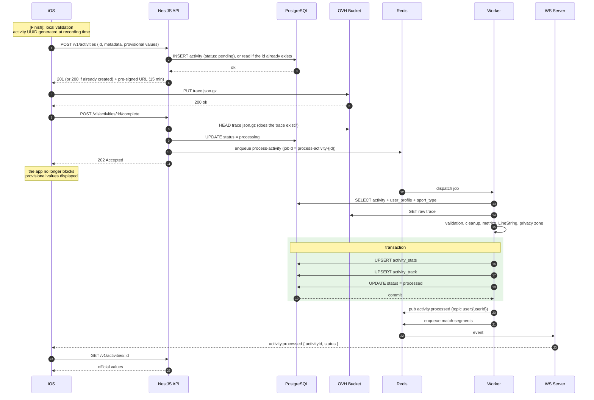

# ADR-019: Activity creation flow

- **Status**: accepted
- **Date**: 2026-09-24
- **Deciders**: echimine
- **Tags**: activities, sync, worker, idempotency
- **Source**: Like-Strava architecture deck, slide 10 "Feature · activity creation"

## Context

Slide 10 describes the journey of an activity, from the end of recording on the iPhone to the official values computed by the worker. Several ADRs left open questions about this flow (ADR-008, ADR-011, ADR-017):
- what the API responds when an activity is created twice (replayed call);
- what to do if the upload URL to the bucket has expired;
- when and how an activity moves to `failed`;
- when segment efforts are computed.

Strong constraint: the mobile app can lose the network **at any step** and replay its calls (ADR-008). Each step must therefore be **replayable without side effects**.

## Decision

### Overview

Differences from slide 10: versioned `/v1` routes (ADR-009), trace check before enqueueing, minimal WebSocket event followed by a reload through the API (ADR-010), "upsert" writes so the job can be replayed, and segment computation in a separate job.

### 1. Creation: `POST /v1/activities`

**The identifier (UUID) is generated by the app** at the start of recording (ADR-008, ADR-017) and sent in the body.

Body (Zod schema in `packages/contracts`): `id`, `sportTypeCode`, `title`, `description`, `startedAt`, `endedAt`, `visibility`, `isManual`, and the **provisional values** computed by the app (distance, durations, elevation gain). These values are not stored as official: the worker recomputes everything, and only compares them to log significant discrepancies.

| Situation | Response |
|---|---|
| New `id` | `201` + activity (`pending`) + upload URL |
| Existing `id`, same user, `pending` activity | `200` + activity + **new** upload URL (replayed call) |
| Existing `id`, same user, activity already `processing` / `processed` | `200` + activity, without URL |
| Existing `id`, other user | `409` |
| Invalid data (inactive sport type, `endedAt` ≤ `startedAt`, duration below the sport's minimum) | `422` with field details |

**Upload URL**: pre-signed `PUT`, valid for **15 minutes**, key `activities/{userId}/{activityId}/trace.json.gz`, enforced content type.

### 2. URL renewal: `POST /v1/activities/:id/upload-url`

- Returns a new URL if the activity is still `pending`, otherwise `409`.
- Used by the app if the URL has expired (ADR-008: `403` response from the bucket).

### 3. Trace upload

- The app sends `trace.json.gz` **directly to the bucket** (ADR-001), via a background `URLSession` (ADR-008).
- Format: compressed JSON, versioned schema in `packages/contracts` (timestamped points: latitude, longitude, altitude, accuracy, speed, heart rate if available).

### 4. Upload completion: `POST /v1/activities/:id/complete`

1. The API checks that the trace exists in the bucket (`HEAD`) and that its size stays under a limit (a pre-signed `PUT` URL cannot enforce the size). Otherwise `409` (`trace_missing` or `trace_too_large`).
2. If the activity is `pending`: moves to `processing`, then enqueues `process-activity` with the job identifier `process-activity-{activityId}` (*amended by [ADR-028](ADR-028-activity-import-from-file.md)*: `-` instead of `:`, which BullMQ 6 rejects in custom job ids). Response `202`.
3. If the activity is already `processing` or `processed`: `202` without enqueueing again (replayed call).
4. If the activity is `failed`: `409`; reprocessing is triggered from the backoffice.

If enqueueing fails after the move to `processing`, the **reconciliation job** (see §7) re-enqueues the activity.

### 5. Processing: `process-activity` job

1. Read the activity, the profile (privacy zone) and the sport type.
2. Download and **validate** the trace (Zod schema). Unreadable or empty trace: permanent failure.
3. **Cleanup**: remove points that are too inaccurate, speed jumps that are impossible for the sport, duplicate timestamps.
4. **Metrics**: distance, moving time and total time, elevation gain (smoothed altitude), average and maximum speeds, heart rate, calories. *Amended by [ADR-030](ADR-030-itineraries-on-ios.md)*: distance and elevation gain come from `@repo/geo`; the gain is computed on the cleaned trace resampled every ~20 m with a 2 m hysteresis (parameters passed as arguments), which is what "smoothed altitude" now means. Activities processed earlier keep their figures.
5. **Route**: simplified `LineString` and start point, in SRID 4326 (ADR-017).
6. **Privacy zone**: the first and last meters of the route (radius `privacy_zone_radius_m` from the profile) are removed from the route stored in `activity_track`, which is the version shown to others. The full raw trace stays private in the bucket.
7. **Transaction**: upsert of `activity_stats`, upsert of `activity_track`, move to `processed` (`processed_at`).
8. **After the commit**: publish `activity.processed` (topic `user:{userId}`, content `{ activityId, status }`), enqueue `match-segments`, PostHog event `activity_processed`. *Amended by [ADR-021](ADR-021-bounded-contexts-and-module-boundaries.md)*: the module emits the domain event `activities.activity.processed`, which the realtime bridge forwards as `activity.processed`; `match-segments` is enqueued by the worker processor.

Upsert writes make the job **replayable without duplicates**.

### 6. Failures

| Error type | Handling |
|---|---|
| Technical (database, bucket, Redis unavailable) | Retry, **5 in total**, exponential backoff (30 s, 1 min, 2 min, 4 min, 8 min) |
| Invalid data (unreadable trace, empty, no usable point) | **Immediate permanent failure** (BullMQ `UnrecoverableError`), without retry |

On permanent failure:
- `activity.processing_status = failed`, with `processing_error` (code: `invalid_trace`, `empty_trace`, `processing_error`…) and `processing_attempts`;
- publish `activity.failed` (topic `user:{userId}`) and PostHog event `activity_failed` (*through the realtime bridge, [ADR-021](ADR-021-bounded-contexts-and-module-boundaries.md)*);
- the app shows the activity as failed and keeps its points (ADR-008);
- reprocessing possible from the backoffice: `POST /v1/admin/activities/:id/reprocess` (moves back to `processing` and re-enqueues).

Target job duration: **under 30 seconds**, compatible with the worker's 120-second shutdown grace period (ADR-018).

### 7. Reconciliation

A recurring job (every 10 minutes) re-enqueues activities that have stayed `processing` for more than 15 minutes without an active job. It covers a failed enqueue, a lost job, or a loss of Redis data (ADR-018). It relies on the partial index on `processing_status` (ADR-017).

Activities that stay `pending` (trace never uploaded, app offline for a long time) are not deleted automatically in the MVP: the app can resume the upload at any time thanks to URL renewal.

### 8. Segments: `match-segments` job

- Enqueued **after** `process-activity`, with the identifier `match-segments-{activityId}`. It does not delay the official values.
- Search for candidate segments of the same sport near the route (GiST index), then check that the route actually follows the segment from end to end (tolerance of a few tens of meters).
- For each segment covered: compute the time from the raw trace, upsert `segment_effort`, **recompute the segment's leaderboard** (`rank`).
- `private` activities do not appear in public leaderboards.
- A failure of the segment computation **does not change** the activity's status: it stays `processed`. The job has its own retries.
- End of the job: `activity.segments_matched` event (topic `user:{userId}`), so the app reloads the efforts if the screen is open (*emitted as `segments.efforts.matched` and forwarded by the realtime bridge, [ADR-021](ADR-021-bounded-contexts-and-module-boundaries.md)*).

### 9. Mobile side

| Local state (ADR-008) | Trigger |
|---|---|
| `recorded` → `created` | `201` or `200` response from `POST /v1/activities` |
| `created` → `trace_uploaded` | `200` response from the bucket |
| `trace_uploaded` → `processing` | `202` response from `complete` |
| `processing` → `processed` | `activity.processed` event or resync, then `GET /v1/activities/:id` |
| `processing` → `failed` | `activity.failed` event or resync |

### 10. Data model changes (amends ADR-017)

Additions to the `activity` table:

| Column | Type | Role |
|---|---|---|
| `processing_error` | `text` (code) | Reason for the permanent failure |
| `processing_attempts` | `int` | Number of worker attempts |
| `processed_at` | `timestamptz` | End of processing |

## Alternatives Considered

| Option | Why rejected |
|---|---|
| Identifier generated by the database | A `POST` replayed after a lost response creates a duplicate; the offline app has no identifier for its local record |
| Identifier generated by the database + idempotency key | Avoids duplicates, but adds a column and a local identifier ↔ server identifier mapping on the mobile side |
| Send the trace in the `POST` to the API | Contradicts ADR-001: large files go directly through the bucket |
| Enqueue without checking that the trace exists | Jobs doomed to fail if the app calls `complete` too early |
| Segments in `process-activity` | Official values delayed; a segment problem would make the whole activity fail |
| Push the official values in the WebSocket event | Two data sources for the mobile app (ADR-010) |
| Automatic deletion of old `pending` activities | Risk of deleting the activity of a user who stayed offline for a long time |

## Consequences

### Positive
- Each step can be replayed without duplicates: creation, URL renewal, `complete`, jobs.
- No activity stuck indefinitely thanks to retries, the `failed` state and reconciliation.
- Official values available quickly; segments computed afterwards, without delaying them.
- The raw trace stays private; only a route truncated around the home is shown to others.

### Negative / Risks
- **Three network calls** on the app side (creation, upload, `complete`): the sync state machine (ADR-008) must be well tested, one network drop at a time.
- **Trace size** not limited by the pre-signed URL: only checked at `complete` time.
- **Algorithms** (cleanup, elevation gain, segment detection) to be calibrated on real traces; the first versions will be approximate.
- **Segment leaderboard recomputation** on every new effort: to be monitored once popular segments have many efforts.

## References
- Like-Strava architecture deck, slide 10
- [ADR-008: Mobile offline and sync](ADR-008-mobile-offline-sync.md)
- [ADR-010: Backend · realtime app](ADR-010-backend-realtime.md)
- [ADR-011: Backend · worker app](ADR-011-backend-worker.md)
- [ADR-017: Data model](ADR-017-data-model.md)
- BullMQ, retries and permanent errors: https://docs.bullmq.io/guide/retrying-failing-jobs

## Links

- **Amends**: [ADR-017](ADR-017-data-model.md) (processing-tracking columns), [ADR-011](ADR-011-backend-worker.md) (jobs and failure policy)
- **Amended by**: [ADR-021](ADR-021-bounded-contexts-and-module-boundaries.md) (realtime events through the bridge)
- **Extended by**: [ADR-028](ADR-028-activity-import-from-file.md) (activities imported from a file are created by the worker directly in `processing`, then follow §5-8)
- **Amended by**: [ADR-028](ADR-028-activity-import-from-file.md) (job id separator `-`)
- **Amended by**: [ADR-030](ADR-030-itineraries-on-ios.md) (§5 elevation-gain algorithm shared with Itineraries in `@repo/geo`)
- **Related**: [ADR-001](ADR-001-global-architecture.md), [ADR-008](ADR-008-mobile-offline-sync.md), [ADR-009](ADR-009-backend-api.md), [ADR-010](ADR-010-backend-realtime.md), [ADR-018](ADR-018-docker-vps-deployment.md)
