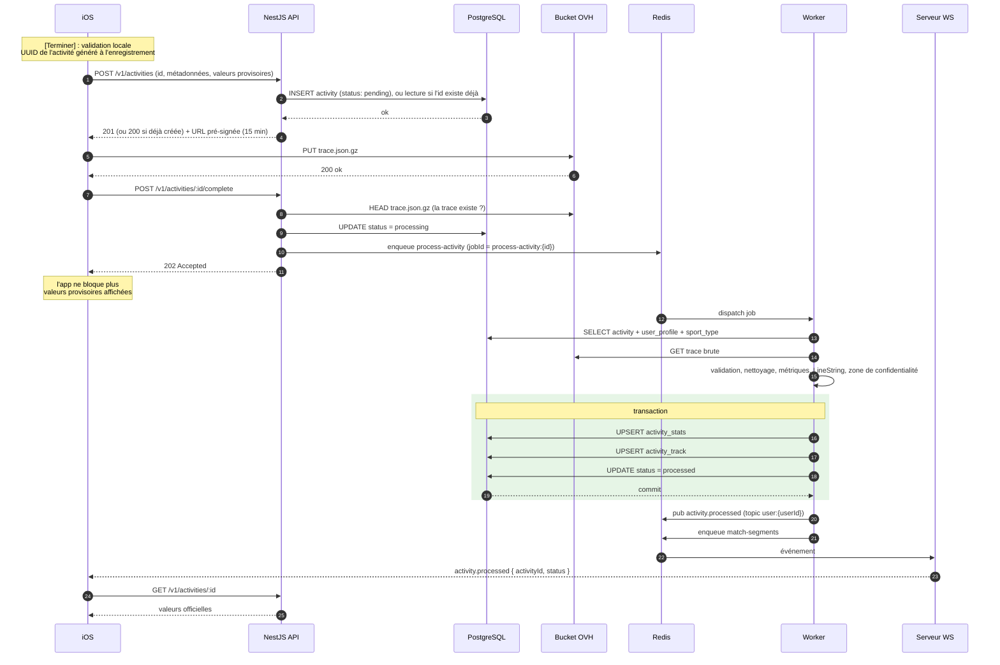

# ADR-019 : Flux de création d'une activité

- **Statut** : accepted
- **Date** : 2026-09-24
- **Décideurs** : echimine
- **Source** : dossier d'architecture Like-Strava, slide 10 « Feature · création d'activité »
- **Amende** : [ADR-017](ADR-017-modele-de-donnees.md) (colonnes de suivi du traitement), [ADR-011](ADR-011-backend-worker.md) (jobs et politique d'échec)
- **En lien avec** : [ADR-001](ADR-001-architecture-globale.md), [ADR-008](ADR-008-mobile-offline-sync.md), [ADR-009](ADR-009-backend-api.md), [ADR-010](ADR-010-backend-realtime.md), [ADR-018](ADR-018-docker-deploiement-vps.md)

## Contexte

La slide 10 décrit le parcours d'une activité, de la fin de l'enregistrement sur l'iPhone jusqu'aux valeurs officielles calculées par le worker. Plusieurs ADR ont laissé des points ouverts sur ce flux (ADR-008, ADR-011, ADR-017) :
- que répond l'API quand une activité est créée deux fois (appel rejoué) ;
- que faire si l'URL d'envoi vers le bucket a expiré ;
- quand et comment une activité passe en `failed` ;
- quand les efforts sur les segments sont calculés.

Contrainte forte : le mobile peut perdre le réseau **à n'importe quelle étape** et rejouer ses appels (ADR-008). Chaque étape doit donc pouvoir être **rejouée sans effet de bord**.

## Décision

### Vue d'ensemble

Différences avec la slide 10 : routes versionnées `/v1` (ADR-009), vérification de la trace avant la mise en file, événement WebSocket minimal suivi d'un rechargement par l'API (ADR-010), écritures en « upsert » pour pouvoir rejouer le job, et calcul des segments dans un job séparé.

### 1. Création : `POST /v1/activities`

**L'identifiant (UUID) est généré par l'app** au début de l'enregistrement (ADR-008, ADR-017) et envoyé dans le corps.

Corps (schéma Zod dans `packages/contracts`) : `id`, `sportTypeCode`, `title`, `description`, `startedAt`, `endedAt`, `visibility`, `isManual`, et les **valeurs provisoires** calculées par l'app (distance, durées, dénivelé). Ces valeurs ne sont pas stockées comme officielles : le worker recalcule tout, et les compare seulement pour journaliser les écarts importants.

| Situation | Réponse |
|---|---|
| Nouvel `id` | `201` + activité (`pending`) + URL d'envoi |
| `id` existant, même utilisateur, activité `pending` | `200` + activité + **nouvelle** URL d'envoi (appel rejoué) |
| `id` existant, même utilisateur, activité déjà `processing` / `processed` | `200` + activité, sans URL |
| `id` existant, autre utilisateur | `409` |
| Données invalides (type de sport inactif, `endedAt` ≤ `startedAt`, durée inférieure au minimum du sport) | `422` avec le détail des champs |

**URL d'envoi** : `PUT` pré-signé, valable **15 minutes**, clé `activities/{userId}/{activityId}/trace.json.gz`, type de contenu imposé.

### 2. Renouvellement de l'URL : `POST /v1/activities/:id/upload-url`

- Renvoie une nouvelle URL si l'activité est encore `pending`, sinon `409`.
- Utilisé par l'app si l'URL a expiré (ADR-008 : réponse `403` du bucket).

### 3. Envoi de la trace

- L'app envoie `trace.json.gz` **directement au bucket** (ADR-001), via une `URLSession` de fond (ADR-008).
- Format : JSON compressé, schéma versionné dans `packages/contracts` (points horodatés : latitude, longitude, altitude, précision, vitesse, fréquence cardiaque si disponible).

### 4. Fin d'envoi : `POST /v1/activities/:id/complete`

1. L'API vérifie que la trace existe dans le bucket (`HEAD`) et que sa taille reste sous une limite (une URL pré-signée `PUT` ne permet pas d'imposer la taille). Sinon `409` (`trace_missing` ou `trace_too_large`).
2. Si l'activité est `pending` : passage en `processing`, puis mise en file de `process-activity` avec l'identifiant de job `process-activity:{activityId}`. Réponse `202`.
3. Si l'activité est déjà `processing` ou `processed` : `202` sans nouvelle mise en file (appel rejoué).
4. Si l'activité est `failed` : `409` ; la relance se fait depuis le backoffice.

Si la mise en file échoue après le passage en `processing`, le **job de réconciliation** (voir §7) remet l'activité en file.

### 5. Traitement : job `process-activity`

1. Lecture de l'activité, du profil (zone de confidentialité) et du type de sport.
2. Téléchargement et **validation** de la trace (schéma Zod). Trace illisible ou vide : échec définitif.
3. **Nettoyage** : suppression des points trop imprécis, des sauts de vitesse impossibles pour le sport, des doublons horodatés.
4. **Métriques** : distance, temps en mouvement et temps total, dénivelé positif (altitude lissée), vitesses moyenne et maximale, fréquence cardiaque, calories.
5. **Tracé** : `LineString` simplifié et point de départ, en SRID 4326 (ADR-017).
6. **Zone de confidentialité** : les premiers et derniers mètres du tracé (rayon `privacy_zone_radius_m` du profil) sont retirés du tracé stocké dans `activity_track`, qui est la version affichée aux autres. La trace brute complète reste privée dans le bucket.
7. **Transaction** : upsert de `activity_stats`, upsert de `activity_track`, passage en `processed` (`processed_at`).
8. **Après le commit** : publication de `activity.processed` (topic `user:{userId}`, contenu `{ activityId, status }`), mise en file de `match-segments`, événement PostHog `activity_processed`.

Les écritures en upsert rendent le job **rejouable sans doublon**.

### 6. Échecs

| Type d'erreur | Traitement |
|---|---|
| Technique (base, bucket, Redis indisponibles) | Nouvelle tentative, **5 au total**, backoff exponentiel (30 s, 1 min, 2 min, 4 min, 8 min) |
| Données invalides (trace illisible, vide, aucun point exploitable) | **Échec définitif immédiat** (`UnrecoverableError` de BullMQ), sans nouvelle tentative |

À l'échec définitif :
- `activity.processing_status = failed`, avec `processing_error` (code : `invalid_trace`, `empty_trace`, `processing_error`…) et `processing_attempts` ;
- publication de `activity.failed` (topic `user:{userId}`) et événement PostHog `activity_failed` ;
- l'app affiche l'activité en échec et garde ses points (ADR-008) ;
- relance possible depuis le backoffice : `POST /v1/admin/activities/:id/reprocess` (repasse en `processing` et remet en file).

Durée cible d'un job : **moins de 30 secondes**, compatible avec le délai d'arrêt de 120 secondes du worker (ADR-018).

### 7. Réconciliation

Un job récurrent (toutes les 10 minutes) remet en file les activités restées `processing` depuis plus de 15 minutes sans job actif. Il couvre une mise en file ratée, un job perdu ou une perte des données Redis (ADR-018). Il s'appuie sur l'index partiel de `processing_status` (ADR-017).

Les activités restées `pending` (trace jamais envoyée, app longtemps hors ligne) ne sont pas supprimées automatiquement au MVP : l'app peut reprendre l'envoi à tout moment grâce au renouvellement d'URL.

### 8. Segments : job `match-segments`

- Mis en file **après** `process-activity`, avec l'identifiant `match-segments:{activityId}`. Il ne retarde pas les valeurs officielles.
- Recherche des segments candidats du même sport proches du tracé (index GiST), puis vérification que le tracé suit bien le segment de bout en bout (tolérance de quelques dizaines de mètres).
- Pour chaque segment parcouru : calcul du temps à partir de la trace brute, upsert de `segment_effort`, **recalcul du classement** (`rank`) du segment.
- Les activités `private` ne figurent pas dans les classements publics.
- Un échec du calcul des segments **ne change pas** le statut de l'activité : elle reste `processed`. Le job a ses propres tentatives.
- Fin du job : événement `activity.segments_matched` (topic `user:{userId}`), pour que l'app recharge les efforts si l'écran est ouvert.

### 9. Côté mobile

| État local (ADR-008) | Déclencheur |
|---|---|
| `recorded` → `created` | Réponse `201` ou `200` de `POST /v1/activities` |
| `created` → `trace_uploaded` | Réponse `200` du bucket |
| `trace_uploaded` → `processing` | Réponse `202` de `complete` |
| `processing` → `processed` | Événement `activity.processed` ou resynchronisation, puis `GET /v1/activities/:id` |
| `processing` → `failed` | Événement `activity.failed` ou resynchronisation |

### 10. Modifications du modèle de données (amende ADR-017)

Ajouts à la table `activity` :

| Colonne | Type | Rôle |
|---|---|---|
| `processing_error` | `text` (code) | Raison de l'échec définitif |
| `processing_attempts` | `int` | Nombre de tentatives du worker |
| `processed_at` | `timestamptz` | Fin du traitement |

## Alternatives envisagées

| Option | Pourquoi écartée |
|---|---|
| Identifiant généré par la base | Un `POST` rejoué après une réponse perdue crée un doublon ; l'app hors ligne n'a pas d'identifiant pour son enregistrement local |
| Identifiant généré par la base + clé d'idempotence | Évite les doublons, mais ajoute une colonne et une correspondance identifiant local ↔ identifiant serveur côté mobile |
| Envoyer la trace dans le `POST` à l'API | Contredit ADR-001 : les fichiers volumineux passent directement par le bucket |
| Mettre en file sans vérifier la présence de la trace | Jobs voués à l'échec si l'app appelle `complete` trop tôt |
| Segments dans `process-activity` | Valeurs officielles retardées ; un problème de segments ferait échouer toute l'activité |
| Pousser les valeurs officielles dans l'événement WebSocket | Deux sources de données pour le mobile (ADR-010) |
| Suppression automatique des activités `pending` anciennes | Risque de supprimer l'activité d'un utilisateur resté longtemps hors ligne |

## Conséquences

### Positives
- Chaque étape peut être rejouée sans doublon : création, renouvellement d'URL, `complete`, jobs.
- Aucune activité bloquée indéfiniment grâce aux tentatives, à l'état `failed` et à la réconciliation.
- Valeurs officielles disponibles rapidement ; segments calculés ensuite, sans les retarder.
- La trace brute reste privée ; seul un tracé tronqué autour du domicile est affiché aux autres.

### Négatives / risques
- **Trois appels réseau** côté app (création, envoi, `complete`) : la machine à états de la synchronisation (ADR-008) doit être bien testée, coupure par coupure.
- **Taille de la trace** non limitée par l'URL pré-signée : contrôlée seulement au moment de `complete`.
- **Algorithmes** (nettoyage, dénivelé, détection des segments) à calibrer sur de vraies traces ; les premières versions seront approximatives.
- **Recalcul du classement** d'un segment à chaque nouvel effort : à surveiller quand les segments populaires auront beaucoup d'efforts.

## Références
- Dossier d'architecture Like-Strava, slide 10
- [ADR-008 : Hors ligne et synchronisation du mobile](ADR-008-mobile-offline-sync.md)
- [ADR-010 : Backend · app realtime](ADR-010-backend-realtime.md)
- [ADR-011 : Backend · app worker](ADR-011-backend-worker.md)
- [ADR-017 : Modèle de données](ADR-017-modele-de-donnees.md)
- BullMQ, tentatives et erreurs définitives : https://docs.bullmq.io/guide/retrying-failing-jobs
