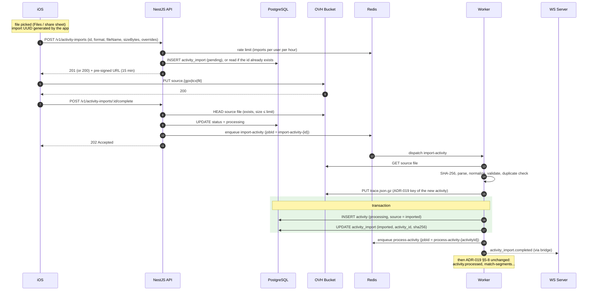

# ADR-028: Activity import from a file (.gpx, .tcx, .fit)

- **Status**: accepted
- **Date**: 2026-10-02
- **Deciders**: echimine
- **Tags**: activities, import, gpx, tcx, fit, worker, idempotency

## Context

ADR-019 describes how an activity **recorded in the app** reaches the backend: the app knows the sport, the start and end times and the provisional values before the first call, and uploads a trace already in our own format (`trace.json.gz`).

Users also want to bring activities recorded elsewhere (a Garmin, Wahoo or Coros watch or bike computer, another app) as a file:

| Format | Nature | Typical source |
|---|---|---|
| **GPX** 1.1 | XML, track points (`trkpt`: lat, lon, `ele`, `time`), heart rate/cadence in Garmin `TrackPointExtension` | Most apps, exports, routes |
| **TCX** | XML (Garmin Training Center), `Activity Sport="Running|Biking|Other"`, laps, track points with HR, cadence, `DistanceMeters` | Older Garmin exports, Garmin Connect |
| **FIT** | Binary (Garmin ANT+ FIT protocol), `session`/`lap`/`record` messages, `sport` enum, semicircle coordinates | All modern watches and bike computers |

ADR-019's flow does not fit as is:
- **The metadata is inside the file**: `startedAt`, `endedAt` and often the sport are only known after parsing, but `activity.started_at` / `ended_at` / `sport_type_code` are `NOT NULL` (ADR-017), and `POST /v1/activities` requires them.
- **Parsing is heavy and can fail** (binary FIT, files of several MB, unsupported or corrupt files): it belongs in the worker (ADR-001, ADR-011), not in the API.
- **The same workout is often imported twice** (the same file twice, or the watch export and the companion app export of the same session).
- The mobile app can lose the network at any step (ADR-008): each step must stay **replayable without side effects**, as in ADR-019.

## Decision

### Overview

An import is its own resource, `activity_import`, owned by the `activities` module. The activity is only created **by the worker, once the file is parsed**; from then on it follows ADR-019's `process-activity` pipeline unchanged.



### 1. Resource and data model (amends ADR-017)

New table `activities.activity_import` (owned by `activities`, ADR-021 §1):

| Column | Type | Role |
|---|---|---|
| `id` | `uuid` PK, **no default** | Generated by the app when the file is picked (same reason as ADR-019 §1: a replayed `POST` never creates a duplicate) |
| `user_id` | `uuid` FK `user` (cascade) | Owner |
| `format` | enum `gpx` / `tcx` / `fit` | Declared by the app from the extension, confirmed by the parser (§5) |
| `original_file_name` | `text` | Shown in the app; default title source |
| `size_bytes` | `int` | Declared size, then the `HEAD` size |
| `sha256` | `text`, nullable | Content hash, set by the worker |
| `status` | enum `pending` / `processing` / `imported` / `duplicate` / `failed` | See §2 |
| `activity_id` | `uuid` FK `activity` (set null), nullable | Created activity (`imported`) **or** existing activity (`duplicate`) |
| `requested_sport_type_code` | `text` FK `sport_type`, nullable | Override chosen in the app |
| `requested_title` | `text`, nullable | Override |
| `requested_visibility` | `visibility`, nullable | Override; default = profile default visibility |
| `error` | `text` (code), nullable | Reason of the permanent failure (§7) |
| `attempts` | `int`, default 0 | Number of worker attempts |
| `created_at`, `processed_at` | `timestamptz` | — |

Indexes:
- `(user_id, created_at desc)`: a user's imports;
- **unique** `(user_id, sha256) where status = 'imported'`: the database itself refuses a second import of the same content (§6);
- partial `(status) where status in ('pending', 'processing')`: reconciliation (§8).

Addition to `activity`: column `source`, enum `recorded` / `imported` / `manual`, default `recorded`. It replaces nothing (`is_manual` stays, ADR-017) and is used for display ("Imported from a .fit file") and analytics.

**The id of the created activity is the id of the import.** Both are app-generated UUIDs in different tables, so reusing the import id makes the worker's `INSERT activity` naturally idempotent (`ON CONFLICT (id) DO NOTHING`) when the job is replayed, with no extra mapping column.

### 2. Import statuses

```
pending ──complete──► processing ──► imported   (activity created, then ADR-019 processing)
                          │     └──► duplicate  (no activity created, activity_id = existing one)
                          └────────► failed     (error code, retry from the backoffice)
```

`imported` and `duplicate` are **final for the import**. What happens to the activity afterwards (`processed` / `failed`) is tracked on the activity itself (ADR-019).

### 3. API

All routes are versioned and authenticated (ADR-009), and use Zod schemas from `packages/contracts`.

#### `POST /v1/activity-imports`

Body: `id`, `format`, `fileName`, `sizeBytes`, optional `sportTypeCode`, `title`, `visibility`.

| Situation | Response |
|---|---|
| New `id` | `201` + import (`pending`) + upload URL |
| Existing `id`, same user, `pending` | `200` + import + **new** upload URL |
| Existing `id`, same user, any other status | `200` + import, without URL |
| Existing `id`, other user | `409` |
| `sizeBytes` above the limit, unknown or inactive `sportTypeCode`, extension not matching `format` | `422` with field details |
| Rate limit exceeded (§9) | `429` with `Retry-After` |

**Upload URL**: pre-signed `PUT`, 15 minutes, key `imports/{userId}/{importId}/source.{gpx|tcx|fit}`, enforced content type `application/octet-stream` (the three formats have no reliably-set MIME type on iOS).

#### `POST /v1/activity-imports/:id/upload-url`

New URL if the import is still `pending`, otherwise `409` (same as ADR-019 §2).

#### `POST /v1/activity-imports/:id/complete`

1. `HEAD` of the source file. Missing: `409 file_missing`. Above the limit: `409 file_too_large` (a pre-signed `PUT` cannot enforce the size, ADR-019 §4).
2. `pending`: move to `processing`, enqueue `import-activity` with jobId `import-activity-{importId}`, `202`.
3. `processing` / `imported` / `duplicate`: `202` without enqueueing again (replayed call).
4. `failed`: `409`; reprocessing from the backoffice (§7).

#### `GET /v1/activity-imports/:id`

Returns the import (`status`, `activityId`, `error`). Used after an `activity_import.*` event or on resync. `GET /v1/activity-imports?status=…` (paginated, ADR-009) lists the user's recent imports for the import screen.

### 4. Worker: `import-activity` job

Queue **`imports`** (new, ADR-011), concurrency **2** per worker instance: parsing is CPU-bound, and a burst of imports (a user importing a season of files) must never delay the processing of activities recorded live, which stay on the `activities` queue.

The processor stays thin (ADR-011 §1): it validates the job data, calls `activities.importFromFile(job)`, then **chains** `process-activity` itself when the result is `imported` (ADR-021 §2 rule 2).

Use case steps:
1. Read the import (`processing` expected; any final status: no-op, replayed job). Increment `attempts`.
2. **Download** the source file as a stream, cut off at the size limit.
3. **SHA-256** of the content.
4. **Exact duplicate** (§6, step 1): an `imported` import of the same user with the same hash: status `duplicate`, `activity_id` = that import's activity. End.
5. **Parse** according to the format (§5) into the **normalized trace** of ADR-019 §3 (versioned schema in `packages/contracts`) plus the file metadata (start, end, sport, name). *Amended by [ADR-031](ADR-031-live-recording-on-ios.md)*: the importer writes trace v2, with an empty `pauses`; `trkseg` breaks and FIT timer stops are not turned into Pauses.
6. **Validate** (Zod on the normalized trace, then rules): at least 2 timestamped points with coordinates, `endedAt` > `startedAt`, duration above the sport minimum. Otherwise permanent failure (§7). *Amended (2026-10-16, [ADR-031](ADR-031-live-recording-on-ios.md) §11)*: the moving time and distance the worker will compute (cleaned trace, `computeMetrics`) are also checked: moving time below `min_duration_s` fails with `invalid_duration`, distance below `min_distance_m` with `invalid_distance` (GPS sports only).
7. **Overlap duplicate** (§6, step 2): an existing activity of the same user overlapping in time: status `duplicate`. End.
8. **Resolve** sport, title and visibility (§5 "Metadata").
9. **Write the trace** `activities/{userId}/{activityId}/trace.json.gz` in the bucket (the ADR-019 key). An idempotent `PUT`: a replay overwrites it with identical content.
10. **Transaction**: `INSERT activity` (`id = importId`, `processing_status = processing`, `source = imported`, `ON CONFLICT DO NOTHING`), `UPDATE activity_import` (`imported`, `activity_id`, `sha256`, `processed_at`).
11. **After the commit**: domain event `activities.import.completed` (`importId`, `activityId`, `userId`, `outcome`), analytics `activity_imported` (`format`, `sport`), result `imported` returned to the processor, which enqueues `process-activity` with jobId `process-activity-{activityId}`.

The activity is created **directly in `processing`**: the trace already exists, so ADR-019's `pending` → `complete` steps have no meaning here. If the enqueue of `process-activity` is lost, ADR-019 §7 reconciliation picks the activity up.

The original file is **kept** in the bucket (private) to allow reprocessing when the parsers improve.

### 5. Parsers

Parsers live in a dedicated package, **`packages/track-files`** (`@repo/track-files`): pure functions, no NestJS, no database, no bucket, tested on real fixture files (ADR-024). One parser per format, all returning the same `ParsedTrackFile` shape: points with **optional** timestamps, altitude, heart rate and cadence, plus the file metadata (sport as written in the file, name, start/end when present).

The package applies **no business rule**: it does not require timestamps, does not map sports to `sport_type.code`, does not filter points. Each consumer applies its own rules. For an activity import, the `activities` module requires timestamps (`no_timestamps`) and maps the sport. A future **route import** (a planned route, not a recorded activity) will reuse the same parsers from its own module, where points without timestamps are valid. Keeping the parsers outside `activities` is what allows that reuse without breaking ADR-021's layering (a module of the same or a lower layer may not depend on `activities`).

Route import itself (table, module, flow) is **out of scope** and will get its own ADR. It will follow the same upload / `complete` / job pattern, on its own queue in the same `apps/worker` process.

| Format | Library | Notes |
|---|---|---|
| GPX | `fast-xml-parser` | Points from every `trk/trkseg/trkpt`; HR/cadence from `gpxtpx:TrackPointExtension`; `rte` and `wpt` ignored (a route is not an activity) |
| TCX | `fast-xml-parser` | All `Lap/Track/Trackpoint` of the first `Activity`; `Sport` attribute; `Position` absent on indoor points |
| FIT | `@garmin/fitsdk` (official Garmin JavaScript SDK) | `record` messages (semicircles → degrees, `enhanced_altitude`/`enhanced_speed` preferred), `session.sport` / `sub_sport`; files with several sessions (multisport): first session only in the MVP |

Common rules:
- **Format sniffing** before parsing: FIT header (`.FIT` signature at bytes 8-11), XML root `<gpx>` / `<TrainingCenterDatabase>`. A mismatch with the declared format is trusted to the content and logged, not rejected.
- **XML hardening**: no DTD, no external entities (XXE), bounded depth.
- **Point limit**: 200,000 points (≈ 55 h at 1 Hz). Above that, permanent failure `too_many_points`.
- **Timestamps**: always UTC in the normalized trace. A GPX without `time` on its points is not an activity: `no_timestamps`.

**Metadata** (sport, title, visibility), in priority order:
1. the override sent in `POST /v1/activity-imports`;
2. the file: FIT `sport`/`sub_sport`, TCX `Sport`, GPX `trk/type`, mapped to `sport_type.code` by a mapping table in the `activities` module (not in `@repo/track-files`) (unknown values ignored); title from GPX `trk/name` / `metadata/name`;
3. defaults: sport → failure `unknown_sport` (the app asks the user to pick one and retries with a new import); title → generated from sport and time of day ("Morning ride"), as for recorded activities; visibility → profile default.

**Indoor files without GPS** (treadmill, home trainer): not supported in the MVP, permanent failure `no_gps_data`. Supporting them needs an activity without `activity_track`, to be specified with indoor recording.

### 6. Duplicates

Two checks, in this order, both scoped to the user:
1. **Exact content**: same SHA-256 as an `imported` import. Cheap, before parsing. Backed by the unique partial index (§1), so two concurrent imports of the same file cannot both succeed: the losing transaction fails on the constraint and the use case turns it into `duplicate`.
2. **Same workout**: an existing activity (recorded or imported, any status except `failed`) whose interval `[started_at, ended_at]` overlaps the parsed interval by **more than 50 % of the shorter one**. Catches the same session exported from two devices or apps.

Outcome: import status `duplicate`, `activity_id` = the existing activity, **no new activity**. The app shows "Already imported" with a link to it. Forcing an import despite a duplicate is out of MVP scope.

### 7. Failures

Same policy as ADR-019 §6:

| Error type | Handling |
|---|---|
| Technical (database, bucket, Redis) | Retry, **5 in total**, exponential backoff (30 s → 8 min) |
| Invalid file | **Immediate permanent failure** (`UnrecoverableError`), no retry |

Error codes (`activity_import.error`): `invalid_file` (unreadable, corrupt FIT CRC, malformed XML), `unsupported_format`, `no_timestamps`, `no_gps_data`, `empty_track`, `too_many_points`, `invalid_duration`, `invalid_distance` (*added 2026-10-16*), `unknown_sport`, `processing_error` (technical retries exhausted).

On permanent failure: status `failed`, `error`, `processed_at`; domain event `activities.import.failed`; analytics `activity_import_failed` (`format`, `error`). Reprocessing: `POST /v1/admin/activity-imports/:id/reprocess` (back to `processing`, re-enqueue).

A failure **after** the import (in `process-activity`) is an activity failure, handled by ADR-019 §6; the import stays `imported`.

### 8. Reconciliation

The recurring reconciliation sweep (ADR-019 §7, every 10 minutes) also re-enqueues imports left `processing` for more than 15 minutes without an active job. Imports left `pending` are never deleted automatically; their source file key is simply unused.

### 9. Redis

- **Queue** `imports`, job `import-activity`, deterministic jobId `import-activity-{importId}` (ADR-011 §2), `removeOnFail` limited as for the other queues.
- **Job id separator**: `-`, not `:`. BullMQ 6 rejects custom job ids containing `:`, so the `{job}:{id}` form written in ADR-011 and ADR-019 never worked; all deterministic job ids (`process-activity-…`, `match-segments-…`, `sync-subscription-…`, `import-activity-…`) use `-`.
- **Re-enqueueing** a deterministic id: BullMQ silently ignores an `add` while a finished job still holds the id, so reconciliation and reprocessing remove a completed or failed job first, and skip a live one.
- **Rate limit** on `POST /v1/activity-imports`: **30 imports per user per hour**, fixed window, key `ratelimit:activity-imports:{userId}` (`INCR` + `EXPIRE` on the first hit). Only new imports count; replayed calls on an existing id do not. A Redis failure lets the request through (fail-open, logged): rate limiting protects the worker, it is not a security boundary.
- **AOF persistence** stays required (ADR-011 "Redis is critical"); reconciliation covers the loss of queued jobs.

### 10. Realtime (amends ADR-010, ADR-021 §4)

New entries in the realtime bridge's forwarding table:

| Domain event | Mobile event | Topic | Data |
|---|---|---|---|
| `activities.import.completed` | `activity_import.completed` | `user:{userId}` | `{ importId, activityId, status: "imported" \| "duplicate", at }` |
| `activities.import.failed` | `activity_import.failed` | `user:{userId}` | `{ importId, status: "failed", code, at }` |

As for every mobile event, the payload is minimal and the app reloads through `GET /v1/activity-imports/:id` (ADR-010 §5). After `activity_import.completed` with `imported`, the usual `activity.processed` / `activity.failed` / `activity.segments_matched` follow for `activityId`. `code` is sent because it is the only thing the app shows for a failed import, and it contains no personal data.

### 11. Limits

| Limit | Value | Where |
|---|---|---|
| File size | **25 MB** | `422` on the declared size, `409` on `HEAD`, stream cut-off in the worker |
| Points | 200,000 | Worker (`too_many_points`) |
| Rate | 30 imports / user / hour | API, Redis |
| Job duration target | under 30 s | Compatible with ADR-018's 120 s worker grace period |

## Alternatives Considered

| Option | Why rejected |
|---|---|
| Reuse `POST /v1/activities` with `source = file` | `started_at` / `ended_at` / `sport_type_code` would have to become nullable on `activity` until parsing, and every reader of `activity` would have to handle half-created activities |
| Parse the file in the API (multipart upload) | Contradicts ADR-001 (large files go through the bucket) and ADR-003 (heavy work in the worker) |
| Parse on the iPhone and reuse ADR-019 as is | Three parsers to maintain in Swift; no reprocessing when parsers improve; no import from the backoffice or a future web client |
| Same `activities` queue for imports | A bulk import would delay the processing of activities recorded live |
| Duplicate detection by hash only | Misses the most common case: the same session exported by the watch app and by another app |
| Create the activity with a server-generated id | A replayed job would need a lookup by import before inserting; reusing the app-generated import id is idempotent by construction |
| Third-party FIT parsers (`fit-file-parser`) | Unofficial, lags behind new FIT profile versions; kept as fallback if the official SDK does not build with our toolchain (TS 7, ESM) |

## Consequences

### Positive
- ADR-019's processing pipeline (`process-activity`, segments, realtime events) is reused unchanged: an imported activity is indistinguishable from a recorded one after import.
- Every step is replayable: creation, URL renewal, `complete`, `import-activity` (idempotent insert, idempotent trace `PUT`).
- Duplicates are refused at the database level for identical files, and detected by time overlap for the same session from different sources.
- Original files are kept, so imports can be reprocessed when parsers improve. *Amended by [ADR-033](ADR-033-activity-detail-edit-delete.md)*: until the Activity is deleted, which deletes its original file.

### Negative / Risks
- **Three parsers to maintain**, with many vendor variants (GPX extensions, FIT developer fields); fixtures from real devices are needed for each.
- **`@garmin/fitsdk` compatibility** with TypeScript 7 and ESM is not verified yet; fallback above.
- **Indoor activities** (no GPS) are refused in the MVP, which will frustrate treadmill and home-trainer users.
- **Overlap rule** (50 %) can refuse a legitimate activity (e.g. two short activities inside a long one); forcing an import is not possible in the MVP.
- **Storage**: original files are kept indefinitely (a few MB per import). *Amended by [ADR-033](ADR-033-activity-detail-edit-delete.md)* (§6): deleting the Activity deletes `imports/{userId}/{importId}/source.{format}`; the `activity_import` row stays with `activity_id = null`.

## References
- GPX 1.1 schema: https://www.topografix.com/GPX/1/1/
- Garmin TCX schema (TrainingCenterDatabase v2): https://www8.garmin.com/xmlschemas/TrainingCenterDatabasev2.xsd
- Garmin FIT SDK (JavaScript): https://developer.garmin.com/fit/
- [ADR-019: Activity creation flow](ADR-019-activity-creation-flow.md)

## Links

- **Depends on**: [ADR-019](ADR-019-activity-creation-flow.md), [ADR-021](ADR-021-bounded-contexts-and-module-boundaries.md)
- **Amended by**: [ADR-031](ADR-031-live-recording-on-ios.md) (trace v2), [ADR-033](ADR-033-activity-detail-edit-delete.md) (original file deleted with its Activity)
- **Amends**: [ADR-017](ADR-017-data-model.md) (`activity_import` table, `activity.source`), [ADR-011](ADR-011-backend-worker.md) (`imports` queue, `import-activity` job), [ADR-010](ADR-010-backend-realtime.md) (`activity_import.*` mobile events), [ADR-021](ADR-021-bounded-contexts-and-module-boundaries.md) (bridge forwarding table, `activities` owns `activity_import`)
- **Related**: [ADR-001](ADR-001-global-architecture.md), [ADR-008](ADR-008-mobile-offline-sync.md), [ADR-009](ADR-009-backend-api.md), [ADR-018](ADR-018-docker-vps-deployment.md), [ADR-024](ADR-024-backend-testing-strategy.md)
